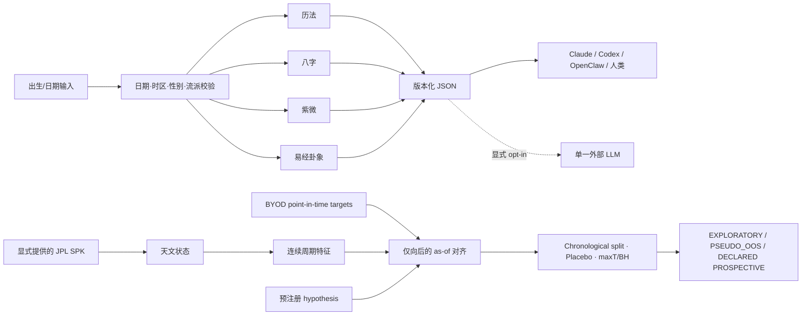

# 🔮 Destiny

### 先排盘，再说人话；先做实验，再谈星辰。

[](https://github.com/harryhuang0719/Destiny/actions/workflows/ci.yml)
[](LICENSE)
[](https://www.python.org/)

Destiny 是一个离线优先、可审计的传统命理计算 Skill，也是一套谨慎的历史天文研究工具。

可以把它想成一张圆桌：

- 历法先生管公历、农历、节气与黄历；
- 八字先生排四柱与大运，但会老实承认“身强身弱”这里只是轻量启发式；
- 紫微先生铺开十二宫，并认真区分 00:00 的早子时和 23:00 的晚子时；
- 易经先生负责起卦、互卦与变卦，但不会冒充尚未实现的完整文王纳甲；
- 桌边还坐着一位很难取悦的量化审计员：他拿 JPL 星历、point-in-time 时间戳、placebo 和多重检验，专门问“这个历史结果会不会只是漂亮的巧合？”

核心原则只有一句：

> **算盘先响，翻译官后开口。** 排盘由确定性代码完成；自然语言只是解释层，不参与偷偷改盘。

同样，历史研究必须有能力得到“这个 MVP 没有发现稳定的预注册单变量关联”这个结论。否则它不是研究，只是一台会讲故事的 p-hacking 机器。带金融控制变量的 M0-vs-M2 增量检验仍属于下一阶段，首版不会偷换概念。

> [!CAUTION]
> Destiny 用于传统文化、娱乐与可证伪的历史关联研究。它不提供医疗、法律、投资建议，也不替任何人做婚姻、职业或人生决定。历史相关性不等于因果，更不等于可交易利润。

## 30 秒启动

需要 Python 3.10+。紫微需要 Node.js 18+。

```bash
git clone https://github.com/harryhuang0719/Destiny.git
cd Destiny
python3 scripts/bootstrap.py
./destiny doctor --json
./destiny bazi 1990 1 15 14 1 --json
```

Bootstrap 会在仓库内创建 `.venv`、固定安装 `lunar-python==1.4.8` 与
`tzdata==2026.3`，并用 `npm ci` 安装锁定的 `iztro==2.5.8`。不会安装
系统软件，不会下载 JPL kernel，也不会下载市场数据。

需要额外能力时再加：

```bash
# 外部 LLM 适配器
python3 scripts/bootstrap.py --llm

# JPL/Skyfield 历史天文研究
python3 scripts/bootstrap.py --research

# 开发测试（可组合）
python3 scripts/bootstrap.py --llm --research --dev
```

没有 Node、只想用历法/八字/易经：

```bash
python3 scripts/bootstrap.py --skip-node
```

Windows：

```powershell
py -3 scripts\bootstrap.py --llm --research
.\destiny.ps1 doctor --json
.\destiny.ps1 bazi 1990 1 15 14 1 --json
```

也可以使用 `destiny.cmd`。

偏好完全冻结的 Python transitive resolution 时，可使用仓库内 `uv.lock`：

```bash
uv sync --frozen --all-extras
npm ci --ignore-scripts
```

`pip install .` / 构建 wheel 会安装 `destiny` Python CLI、核心历法与可选
Skyfield 研究层；wheel 不会安装 npm 的 iztro，因此 wheel 环境中的紫微会
明确退出 3。需要完整 Skill 与紫微时，请使用 Git clone + bootstrap 流程。

## 给 Claude、Codex 与 OpenClaw 安装

仓库根目录就是一个标准 `SKILL.md`，不需要复制三份易漂移的提示词。

### Codex

Codex 当前从个人目录 `~/.agents/skills` 和项目目录 `.agents/skills` 发现 Skill。个人安装：

```bash
git clone https://github.com/harryhuang0719/Destiny.git ~/.agents/skills/destiny
python3 ~/.agents/skills/destiny/scripts/bootstrap.py --research
```

Windows 用 `py -3 ...\scripts\bootstrap.py --research`，运行时使用
`destiny.ps1` 或 `destiny.cmd`。

然后说：

```text
$destiny 帮我把这个公历时间转换成农历，并解释你采用的时间口径
```

也可以让内置 `$skill-installer` 从这个 GitHub 仓库安装。参见 [OpenAI 官方 Skill 文档](https://developers.openai.com/codex/skills/)。

### Claude Code

```bash
git clone https://github.com/harryhuang0719/Destiny.git ~/.claude/skills/destiny
python3 ~/.claude/skills/destiny/scripts/bootstrap.py --research
```

Windows 同样用 `py -3` bootstrap 与 `destiny.ps1` / `destiny.cmd`。

然后使用 `/destiny`，或直接描述八字、紫微、历法、起卦、历史天文查询等需求。Claude Code 的个人与项目 Skill 路径见 [官方文档](https://code.claude.com/docs/en/skills)。

### OpenClaw

OpenClaw 的 Git 安装会寻找仓库根部的 `SKILL.md`。以下命令默认安装到
当前 active workspace；加 `--global` 才会安装到共享 managed skill 目录：

```bash
openclaw skills install git:harryhuang0719/Destiny@main
# 或所有本地 agent 共享：
openclaw skills install git:harryhuang0719/Destiny@main --global
openclaw skills info destiny
```

从 `info` 显示的安装目录运行：

```bash
python3 /显示出来的路径/scripts/bootstrap.py --research
```

之后可用 `$destiny` 或 `/destiny`。参见 [OpenClaw Skills 官方文档](https://docs.openclaw.ai/tools/skills)。

### 项目级安装

希望团队把 Skill 跟项目一起版本化时：

- Codex：克隆到项目的 `.agents/skills/destiny`；
- Claude Code：克隆到项目的 `.claude/skills/destiny`；
- OpenClaw：workspace 级使用默认 Git install；共享级加 `--global`。

## 两条清清楚楚的流水线



第一条线服务传统文化计算；第二条线的 MVP 检验预注册天文特征与市场 target 的单变量历史关联。带普通金融控制变量的真正增量检验尚未实现。两者不能相互偷渡结论：历史市场相关性即使存在，也不能证明个人命盘有效；个人命理解读也不是市场模型的证据。

## 命理 CLI

所有主命令都支持 `--json`。核心默认不联网；`--no-llm` 保留作显式强调。

### 历法与农历转换

```bash
./destiny calendar 2026 8 26 --json
./destiny calendar 2024 2 4 16 --minute 28 --second 0 --json
./destiny lunar 2024 1 1 --json
./destiny lunar 2023 2 1 --leap --json
```

输出包括公/农历、精确与农历年干支、节气精确时间、生肖、宜忌、星宿、彭祖百忌、天神和值星。

### 八字

```bash
./destiny bazi 1990 1 15 14 1 --minute 30 --sect 2 --json
```

- `gender`：`1=男`、`0=女`，这是底层传统算法参数；
- `--sect 1|2`：明确 23:00 附近的换日流派，默认 2；
- 输出四柱、五行、十神、纳音、地势、胎元/命宫/身宫、大运起始日与完整偏移；
- `day_master.strength` 是八个明字等权计数提示，绝不是完整旺衰/用神裁决。

### 紫微斗数

```bash
./destiny ziwei 2000 8 16 23 男 --json
```

紫微通过静态 Node bridge 调用 iztro。出生信息以 JSON 从 stdin 传递，不拼接成 JavaScript；Node 子进程也看不到无关 API key。23:00 使用 iztro 的晚子时 index 12，00:00 使用早子时 index 0。

### 综合、合盘、流年与黄历初筛

```bash
./destiny comprehensive 1990 1 15 14 1 --minute 30 --json
./destiny hepan 1990 1 15 14 1 1992 3 20 8 0 --json
./destiny liunian 1990 1 15 14 1 --year 2026 --json
./destiny zeji 结婚 --month 2026-09 --json
```

`hepan` 如果做真太阳时，必须分别提供两人的地点：

```bash
./destiny hepan 1990 1 15 14 1 1992 3 20 8 0 \
  --city1 上海 --city2 "New York" --minute1 30 --minute2 15 --json
```

`zeji` 是透明的黄历宜忌初筛：活动出现在 `宜` 且不出现在 `忌` 才保留，结果按日期排列，没有神秘隐藏分数，也不保证结果。

### 易经卦象

```bash
./destiny iching manual 789978 --json
./destiny iching time 2024 2 10 12 --json
./destiny iching dayan --seed 42 --json
```

大衍模式使用 `6:7:8:9 = 1:5:7:3` 的传统离散概率，并返回可重放 seed。时间起卦采用一套明确口径：农历月日 + `子=1 … 亥=12` 的地支序数。

把用户原文安全传给 agent：

```bash
./destiny iching dayan --question-stdin --json
```

启动后通过进程 stdin 写入问题。不要写成 `./destiny ... "用户问题"` 再让 agent 做字符串插值，因为 shell 的 `$()` 和反引号会在 Python 之前执行。

当前易经层提供本卦、互卦、变卦、变爻和简要卦辞/指导；不宣称拥有完整爻辞库、纳甲、世应、六亲六兽落爻、旬空、月建日辰旺衰等完整文王卦能力。

## 真太阳时：时间不是一个裸整数

```bash
./destiny bazi 1990 6 15 14 1 --minute 30 --solar --city 上海 --json
./destiny bazi 1990 6 15 14 1 --minute 30 --solar --city "New York" --json
./destiny bazi 1990 6 15 14 1 --minute 30 \
  --solar --longitude 77.21 --tz 5.5 --json
```

城市同时绑定经度与 IANA timezone，因此纽约夏令时不会再被默认成 UTC+8。不存在或歧义的 DST 本地时刻会失败；歧义时可显式给 `--tz`。JSON 同时保留：

- 原始民用时间；
- 城市、IANA zone、历史 UTC offset 与经度；
- 校正后的真太阳时；
- `true-solar-time-v2` 口径版本。

它仍是一套约定明确的近似，不解决所有命理流派争议。详见 [方法论](references/methodology.md)。

## 可选外部 LLM

Agent 通常应该直接解读离线 JSON，不需要再把出生信息发给第二个模型。

如果你明确希望 CLI 调用外部 provider：

```bash
cp .env.example .env
# 只在本机编辑 .env；它已被 gitignore
./destiny bazi 1990 1 15 14 1 \
  --llm --provider minimax --env-file .env --json
```

支持 `minimax`、`deepseek` 与自定义 OpenAI-compatible endpoint。默认只调用你指定的一个。`--llm-fallback` 必须单独写出，因为它可能把同一份出生资料发送给另一个已配置供应商。详情见 [隐私与安全](references/privacy-safety.md)。

## 历史天文查询

历史层来自仓库内保留的 [原始研究 Blueprint](docs/Historical_Astronomical_Data_Financial_Markets_Research_Blueprint.md)，实现修正见 [Blueprint notes](docs/BLUEPRINT_NOTES.md)。

### 1. 明确取得 JPL kernel

Destiny 不会自动下载 32 MB 的 `de440s.bsp`。从 JPL/NAIF 官方目录取得文件并保留来源；文件不应提交 Git。

```bash
mkdir -p data/kernels
curl --fail --location \
  https://naif.jpl.nasa.gov/pub/naif/generic_kernels/spk/planets/de440s.bsp \
  --output data/kernels/de440s.bsp
./destiny history kernel-info --kernel data/kernels/de440s.bsp
```

`kernel-info` 输出 SHA-256；每份 feature manifest 也会记录 kernel hash。`de440s` 覆盖约 1849–2150，适合现代研究。完整 DE440/DE441 是可选外部 kernel，不进入仓库。

### 2. 查询一个历史时刻

```bash
./destiny history astro \
  --kernel data/kernels/de440s.bsp \
  --at 1929-10-24T16:00:00-05:00 \
  --bodies sun,moon,mercury,mars,jupiter,saturn \
  --allow-pre-utc
```

1972 年前，UTC 不是现代严格意义上的统一时间标签；因此命令默认拒绝，只有显式 `--allow-pre-utc` 才会返回带 `proleptic UTC label` 警告的描述性重建。天文内部仍记录 TT/TDB/UT1。

坐标口径写入结果：地心、apparent、ecliptic/equinox of date。每个 body 还记录实际 SPK target 与 NAIF ID；例如 `de440s` 的部分外行星是 system barycenter，不冒充 planet center。

### 3. 构建连续历史特征

先估算，不计算：

```bash
./destiny history build \
  --kernel data/kernels/de440s.bsp \
  --start 2000-01-01T00:00:00Z \
  --end 2026-01-01T00:00:00Z \
  --step-hours 24 --out data/astro_daily.csv --dry-run
```

确认后移除 `--dry-run`。生成内容包括：

- 各天体黄经 `sin/cos`、黄纬、距离、黄经速度、逆行；
- Moon–Sun 有向相位与 illumination；
- 预设 pair 的 signed angle、0–180° separation、相对速度；
- Fourier `k=1,2` 与连续 Gaussian aspect scores；
- CSV 和 `.manifest.json` 的 SHA-256、kernel hash、body target、口径与参数。

更高 harmonic、更多 pair、不同 orb 都是额外 hypothesis，必须在查看 OOS 前固定。

### 4. 导入你自己的 point-in-time target

本仓库不下载、不捆绑、不重新分发行情。先复制 [研究输入模板](examples/research/)：

- `series_catalog.example.json`：精确声明 vendor、series、instrument、venue、时区、calendar、price/target 语义、tradability、vintage 与许可；
- `hypothesis.example.json`：冻结 feature family、方向、有效周期、split、embargo、placebo 次数与 seed；
- `target_schema.csv`：每行必须满足：

```text
observation <= available <= decision < execution <= target_start < target_end
```

日期只有 `2025-01-01` 而没有 offset，会被拒绝。未来 feature join 会被拒绝。VIX、收益率等 indicator 如果标记 `tradable=false`，系统不会伪造策略 Sharpe。

### 5. 运行预注册研究

```bash
./destiny history research \
  --features data/astro_daily.csv \
  --targets /path/to/targets.csv \
  --catalog /path/to/series_catalog.json \
  --hypothesis /path/to/hypothesis.json \
  --trial-registry /path/to/trials.ndjson \
  --out /path/to/result.json
```

默认会验证同目录的 `astro_daily.csv.manifest.json`；若 sidecar 在别处，显式
加 `--feature-manifest /path/to/manifest.json`。manifest、CSV、target、catalog、
hypothesis、registry 与 result 不能互相复用路径或 hard-link identity。

输出包含：

- train / validation / test 的 Pearson 与 Spearman；
- joint circular time-shift placebo、经验 p、familywise maxT 与 BH q；
- 有效周期覆盖与方向稳定性；
- backward-only as-of 对齐、丢弃样本和输入 hashes；
- 每次 trial 都追加 `STARTED`，并最终追加 `COMPLETED` 或 `FAILED` 的 registry；
- 对非重叠、可交易 return target 才会生成的简化 OOS threshold strategy；
- 限制与 evidence status。

状态的含义很克制：

| 状态 | 含义 |
|---|---|
| `EXPLORATORY` | 普通历史探索 |
| `PSEUDO_OOS_ONLY` | 时间上切开，但历史结果早已可见，不是假装封存的确认 |
| `PROSPECTIVE_DECLARED_UNVERIFIED` | 本地时间/Git 门禁通过的 prospective 声明；没有外部时间戳/公证，不能自我认证 |
| `DESCRIPTIVE` | 周期/事件数不足，只能描述 |

第一版故意不会打印 `CONFIRMATORY_PASS`。它当前只有预注册单变量检验，不含金融控制变量或 M0 对 M2 的 paired incremental model。真正强证据还需要完整 pipeline placebo、block/HAC inference、独立 Horizons golden、真实交易日历/early close、M0 对 M2 paired comparison、成本压力与未来 prospective 数据。详见 [历史研究方法](references/historical-research.md)。

## “支持”与“不冒充支持”

| 能力 | 当前实现 | 明确不声称 |
|---|---|---|
| 历法 | 公历/农历双向、节气精确时刻、黄历字段 | 所有民俗流派唯一标准 |
| 八字 | 四柱、十神、纳音、地势、大运 | 完整旺衰/用神裁决 |
| 紫微 | iztro 2.5.8 十二宫与星曜 | 所有紫微门派一致 |
| 易经 | 起卦、本/互/变卦、变爻指导 | 完整纳甲六爻与全爻辞库 |
| 择日 | 宜忌透明初筛 | 成功保证或完整择日术 |
| 历史天文 | 哈希 JPL kernel、连续特征、明确 frame | NASA/JPL 背书或历史 vintage 可执行性 |
| 历史研究 | point-in-time、OOS 流程、placebo/multiplicity | 因果、稳定 alpha、production trading |

## JSON 与退出码

主输出使用 `schema_version: "2.0.0"`；历史研究使用独立 schema。结果包含引擎版本和计算口径，避免升级后静默改义。

| Exit code | 含义 |
|---:|---|
| `0` | 命令成功 |
| `1` | Help/doctor 发现完整引擎尚未就绪 |
| `2` | 输入、配置或研究契约错误 |
| `3` | 紫微 Node/iztro 引擎不可用 |
| `130` | 用户中断 |

JSON 模式 stdout 只输出一个 JSON document；诊断去 stderr，便于 agent 和程序直接 `json.load()`。

## 测试与复现

```bash
python3 scripts/bootstrap.py --llm --research --dev
.venv/bin/python -m pytest -q
npm test
npm audit --omit=dev
```

测试覆盖：

- 立春精确到秒的四柱切换；
- 已知八字与男女大运；
- Bazi sect 1/2 的晚子时差异；
- 八经卦与关键六十四卦 golden；
- 农历梅花时间例、大衍概率桶与 seed replay；
- 紫微早/晚子时不同命盘、`isEmpty()` 与 JS 注入回归；
- Node 子进程无法读取哨兵密钥；
- 纽约 DST、歧义/不存在时间、半小时时区；
- 每个 `--no-llm` 路径、纯 JSON 与恶意问题文本；
- circular geometry、FDR、point-in-time 违例、as-of join、trial registry、placebo 与 indicator 禁止伪回测；
- 可选真实 JPL kernel smoke test。

CI 不调用真实 LLM，不提交或缓存私人数据。

## 项目结构

```text
Destiny/
├── SKILL.md                         # Claude / Codex / OpenClaw 共同入口
├── README.md
├── AGENTS.md / CLAUDE.md
├── destiny / destiny.cmd / destiny.ps1
├── scripts/
│   ├── destiny_analyzer.py          # 统一命理 CLI
│   ├── calendar_engine.py
│   ├── bazi_engine.py
│   ├── ziwei_engine.py + ziwei_bridge.cjs
│   ├── iching_engine.py
│   ├── timezone_util.py
│   ├── historical_research.py       # JPL features + point-in-time research
│   ├── history_cli.py
│   └── bootstrap.py
├── references/                      # 方法、隐私、agent 与历史研究口径
├── docs/                            # 原始 Blueprint 与实现修正
├── examples/research/               # 无市场数据的 schema/config 模板
├── tests/
├── package.json / package-lock.json
└── pyproject.toml
```

## 故障排查

### `Node.js not found` / `Cannot find module 'iztro'`

```bash
node --version
npm ci --ignore-scripts
./destiny doctor --json
```

Node 需 18+。只用非紫微功能可重新 bootstrap `--skip-node`。

### `skyfield` 未安装

```bash
python3 scripts/bootstrap.py --research
```

Skyfield 只是研究 extra，不应拖进普通排盘环境。

### 1972 年前时间被拒绝

这是有意的。现代严格 UTC 不能直接倒贴到 1929 年。若做描述性天文重建，显式加 `--allow-pre-utc`，并保留输出中的时间政策警告。

### JSON 解析失败

确认调用的是主入口并带 `--json`，不要把 stderr 合并进 stdout：

```bash
./destiny bazi 1990 1 15 14 1 --json > chart.json
python3 -m json.tool chart.json
```

## 安全、许可与致谢

- Destiny 源码：MIT，见 [LICENSE](LICENSE)。
- `lunar-python`：MIT；`iztro`：MIT；`httpx`：BSD-3-Clause；Skyfield：MIT。
- 完整说明见 [THIRD_PARTY_NOTICES.md](THIRD_PARTY_NOTICES.md)。
- JPL kernel 是外部数据，不进入仓库；使用者保留来源与 SHA-256。Destiny 不代表 NASA/JPL 背书。
- Swiss Ephemeris / `pyswisseph` 因 AGPL/商业双许可没有被悄悄加入 MIT 核心。
- 不提交 `.env`、出生资料、生成命盘、市场原始数据、JPL kernel、trial registry 或回测结果。

漏洞请按 [SECURITY.md](SECURITY.md) 私下报告；贡献算法或研究方法前请读 [CONTRIBUTING.md](CONTRIBUTING.md)。

如果最后跑出来的结论是“星辰很美，但这个预注册 family 没有稳定的单变量市场关联”，那不是失败——那正是这套系统保持诚实的一刻。
